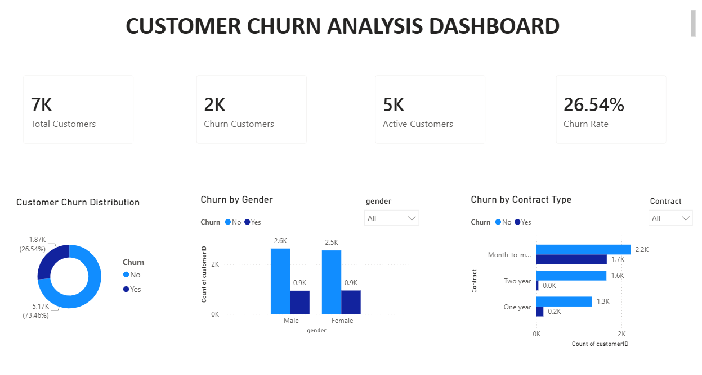
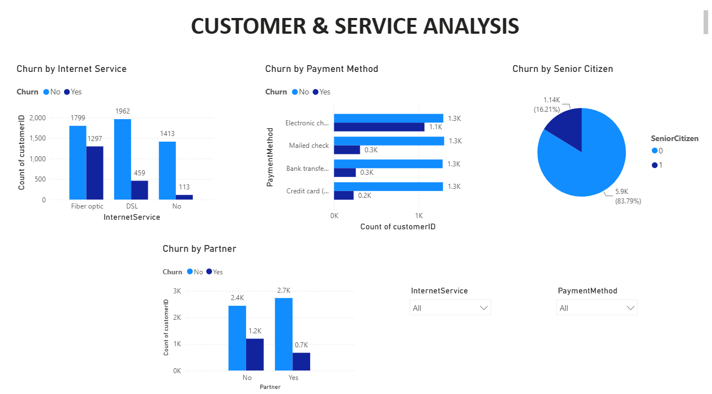
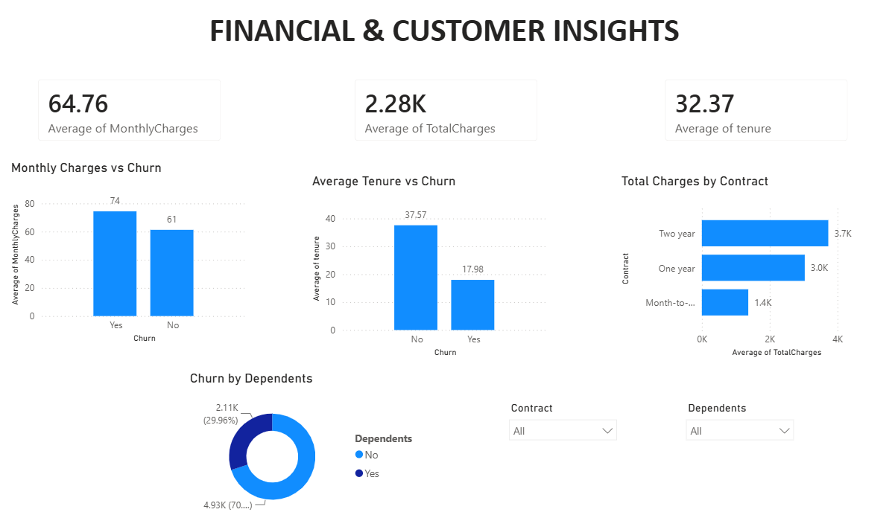
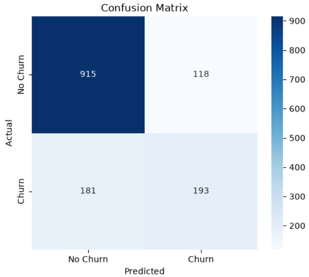

# 📊 Customer Churn Prediction Analysis

## 📌 Project Overview

Customer churn is one of the biggest challenges faced by subscription-based businesses. This project analyzes customer behavior using Python, Machine Learning, and Power BI to identify the factors influencing customer churn and build a predictive model.

The project combines Exploratory Data Analysis (EDA), Logistic Regression, and an interactive Power BI dashboard to provide business insights that help improve customer retention.

---

# 📷 Dashboard Overview

## Executive Overview



---

## Customer & Service Analysis



---

## Financial & Customer Insights



---

## Machine Learning Model Evaluation

### Confusion Matrix



---

# 📂 Project Structure

```
Customer Churn Prediction Analysis
│
├── Dashboard/
├── Dataset/
├── Python/
├── Screenshots/
└── README.md
```

---

# 📈 Machine Learning

Model Used:

- Logistic Regression

Model Performance:

- Accuracy: **78.75%**

Evaluation Metrics:

- Accuracy Score
- Confusion Matrix
- Classification Report

---

# 📊 Dashboard Features

### Executive Overview
- Total Customers
- Active Customers
- Churn Customers
- Churn Rate
- Customer Churn Distribution
- Churn by Gender
- Churn by Contract Type

### Customer & Service Analysis
- Churn by Internet Service
- Churn by Payment Method
- Churn by Senior Citizen
- Churn by Partner
- Interactive Slicers

### Financial & Customer Insights
- Average Monthly Charges
- Average Total Charges
- Average Customer Tenure
- Monthly Charges vs Churn
- Average Tenure vs Churn
- Total Charges by Contract
- Churn by Dependents

---

# 🎯 Key Insights

- Month-to-month contract customers have the highest churn rate.
- Customers with Fiber Optic internet are more likely to churn.
- Customers with shorter tenure have significantly higher churn.
- Customers with higher monthly charges are more likely to leave.
- Long-term contracts greatly improve customer retention.

---

# ✅ Conclusion

This project demonstrates an end-to-end customer churn analysis workflow by combining data cleaning, exploratory analysis, machine learning, and interactive business intelligence dashboards. The insights generated can help businesses understand customer behavior and implement effective retention strategies.
